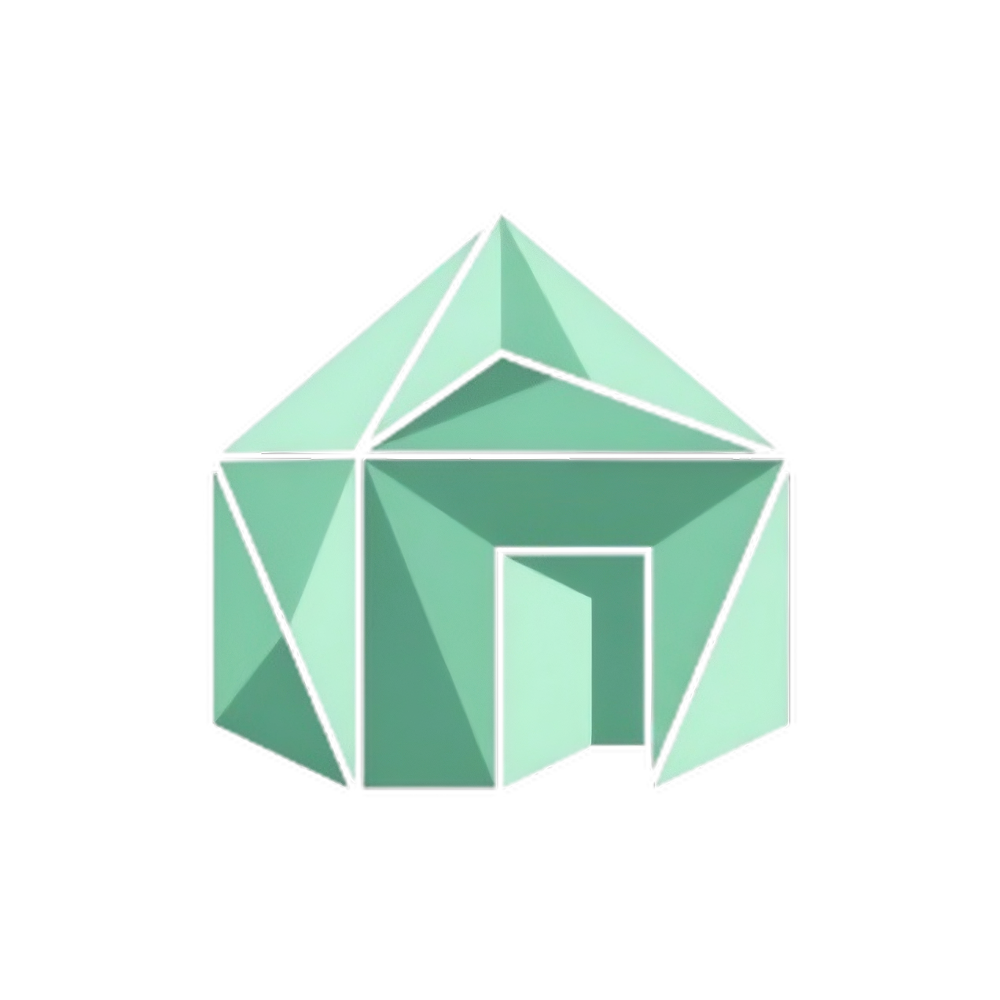
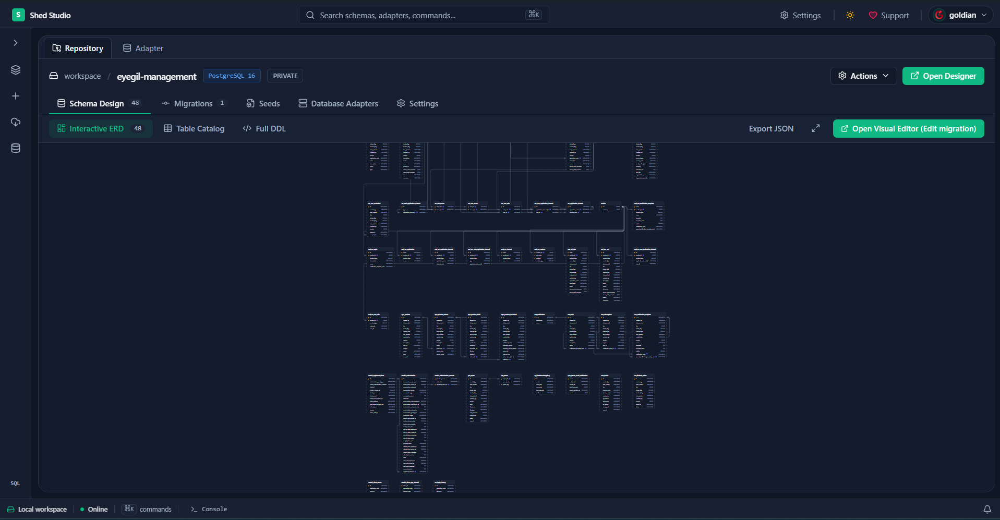

  <!-- Mascot: transparent PNG, about 160px wide. Use public/mascot-512.png from the app. -->
  

<h1 align="center">Shed</h1>

<b>Design your database. Ship your schema.</b>

Shed is a schema designer for developers. Draw your tables and relationships, keep every change as a migration, and bring the result to a real database with a preview and safety checks before anything runs.

Use it in the browser, or install the desktop app to work offline and connect to your own databases.

> This repository publishes the desktop installers and release notes. Get the latest build from [Releases](https://github.com/eyegil/shed/releases).

## What it does

- **Design visually**, or write the schema as SQL and watch the canvas follow.
- **Keep migrations** with Up and Down SQL written for your database, plus seeds, triggers and views.
- **Sync both ways**: bring an existing database into Shed, or apply your schema to a database after seeing exactly what will change.
- **Browse and query** your data, with a read-only switch and warnings before anything risky.
- **Design with AI** through your own local [OpenCode](https://opencode.ai) setup.

.png)

**Databases:** PostgreSQL, MySQL, SQLite and SQL Server (design and live sync); Oracle (design and SQL generation).

## Download

| System | File |
|---|---|
| **Windows 10 / 11** | `Shed-Setup-<version>-jre.exe` (Java included, simplest) or `-nojre.exe` (needs Java 17+) |
| **Linux (Debian, Ubuntu)** | `.deb` (installs Java 17 for you) |
| **Linux (any)** | `.AppImage` (needs Java 17+) |
| macOS | not available yet; use the browser version |

Builds named like `v0.2.0-beta` are pre-releases for testing and are not offered as automatic updates. The Windows app updates itself with signed updates.

Your data stays on your machine in `~/.shed`, the app works offline, and there is no telemetry.

## Learn more

Everything else (setup, connecting a database, migrations, syncing, the query console, AI) is in the **[documentation](https://docs.eyegil.com/shed)**.

## Feedback and support

- Bug or idea? [Open an issue](https://github.com/eyegil/shed/issues) with your system, the Shed version, and what happened.
- Shed is built independently. You can support it on [Ko-fi](https://ko-fi.com/hindreaming), or just star the repo.

---

Made by <a href="https://github.com/hindreaming">Hindreaming</a> | <a href="https://eyegil.com">EyeGil</a>

